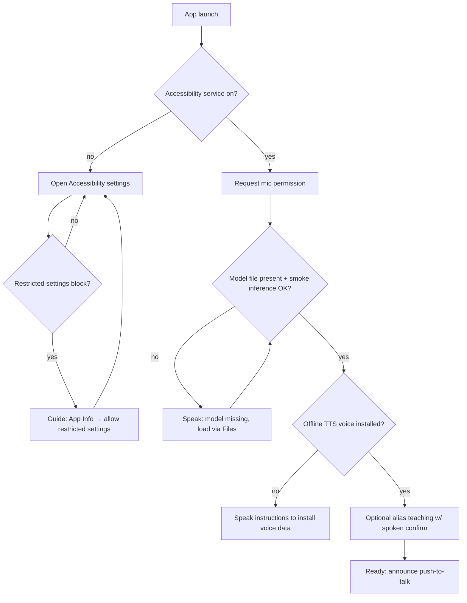
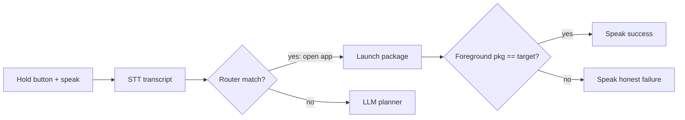
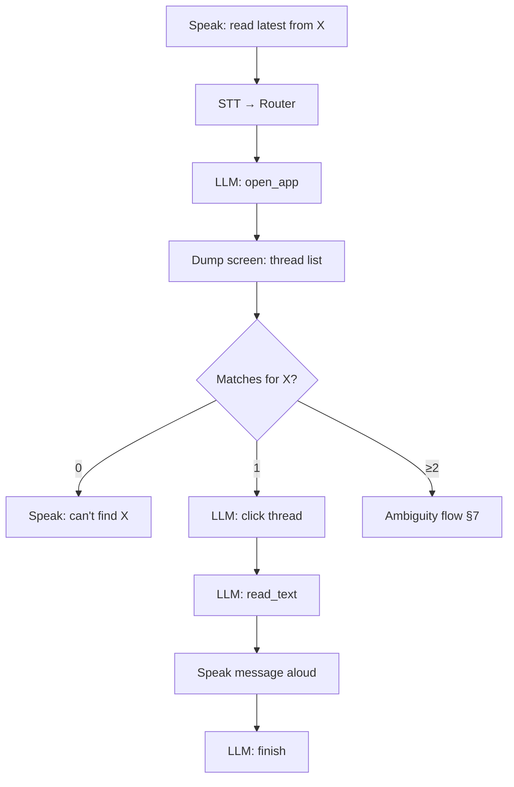
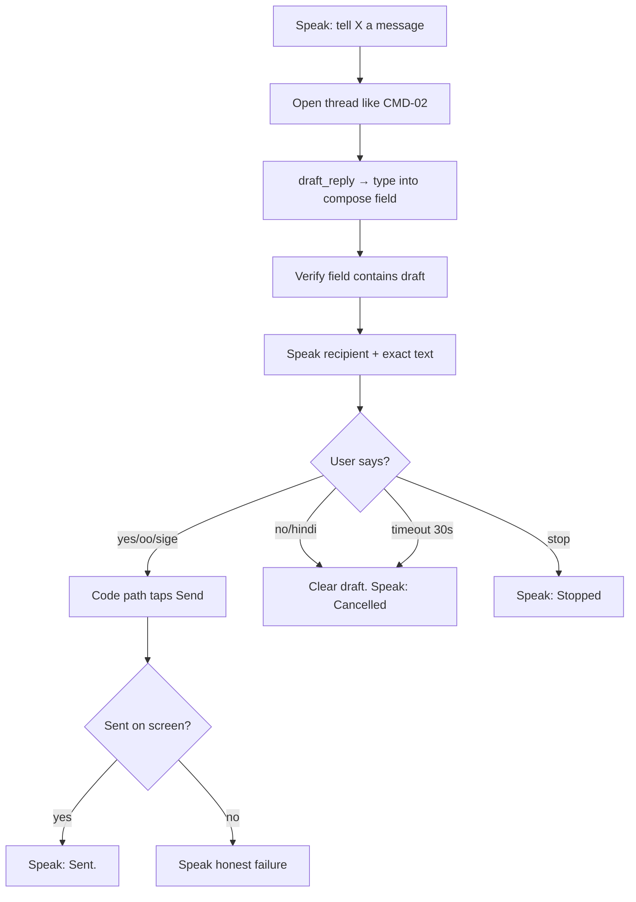
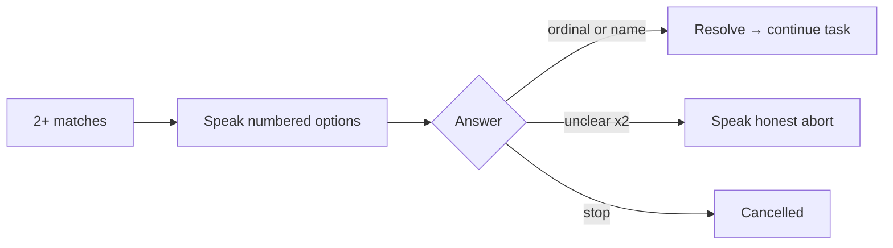
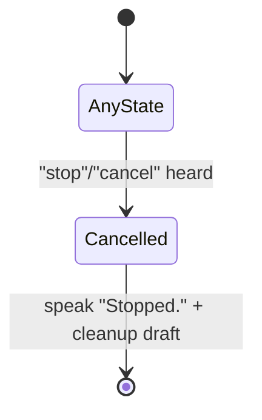
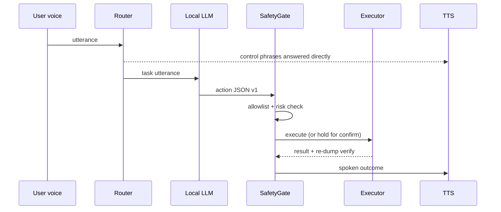

# 03 — User Flow

| | |
|---|---|
| **Upstream** | 01-PRD (FR ids), 02-MVP-Scope (CMD ids, control utterances) |
| **Downstream** | 04-Architecture (state machines), 07-Agent-Specs (spoken templates TPL-xx) |

**Reading convention:** the user may never see the screen. Each step lists **what the user HEARS** (via TTS) and what the system does. Template IDs (TPL-01 …) are defined in 07-Agent-Specs §10. Sounds: a short chime marks "listening started" and "listening ended" — hearing cues are part of the interface.

---

## 1. First-Time Setup Flow (FR-14)

| # | System does | User hears |
|---|---|---|
| 1 | App launches; detects accessibility service is OFF | "Welcome to Alalay. I need permission to see and tap the screen for you. Nothing you say or see ever leaves this phone. Opening settings now." |
| 2 | Opens Accessibility settings | *(system settings UI; TalkBack may be on)* |
| 3 | If Android blocks the toggle (sideloaded APK "restricted settings"), app shows guidance card and a button to App Info | "Android needs one extra step. In the app info screen, tap the three dots, then Allow restricted settings. Then come back." |
| 4 | Service enabled → app auto-detects | "Screen control is on." |
| 5 | Requests RECORD_AUDIO | "I need the microphone to hear your commands." |
| 6 | Checks model file presence + runs 1-token smoke inference; checks offline TTS voice | "Checking my brain… Local model ready. Voice ready." |
| 7 | Optional alias teaching: "You can teach me names, like Mama means Remedios Domingo. Want to add one?" | user speaks alias → repeats back → "Save this? Say yes or no." → stores only on yes (FR-10) |
| 8 | Done | "Setup complete. Press and hold the button, then tell me what to do." |

## 2. CMD-01 — Open an App

| # | System does | User hears |
|---|---|---|
| 1 | User holds button; chime; speaks "Buksan mo ang Messenger"; releases | *(chime)* |
| 2 | STT transcribes; router matches `open <app>` → skips LLM | "Opening Messenger." |
| 3 | Executor launches package; verification = foreground package check | "Messenger is open." or honest failure: "I couldn't find Messenger on this phone." |

## 3. CMD-02 — Read Latest Message

| # | System does | User hears |
|---|---|---|
| 1 | Push-to-talk: "Basahin mo yung huling message ni Mama" | *(chime)* "Okay, getting Mama's latest message." |
| 2 | Router no match → LLM plan step 1: `open_app(messaging app)` | "Opening the app." |
| 3 | ScreenInspector dumps thread list; model picks `click` on row matching alias "Mama" (resolved via MemoryStore) | *(silence ≤8 s/step, then)* "Opening the conversation with Mama." |
| 4 | Model calls `read_text`; SafetyGate redacts nothing needed — content stays on-device but is NOT logged | *(reads message aloud)* "Mama says: 'Nasaan ka na? Dinner is ready.'" |
| 5 | Model calls `finish` | "That's the latest one." |

If **two** contacts/threads match "Mama": run §7 Ambiguity instead of step 3.

## 4. CMD-03 — Reply / Send Message (includes Confirmation Flow, FR-07)

| # | System does | User hears |
|---|---|---|
| 1 | "Sabihin kay Mama, papunta na ako" | *(chime)* "Okay, a message for Mama." |
| 2 | Steps as in CMD-02 to reach the thread (alias resolve, ambiguity if needed) | "Opening the conversation with Mama." |
| 3 | Model calls `draft_reply(text)` → Executor types into the compose field only. **No send action exists in the model's tool set.** | "I've written a draft." |
| 4 | Verification: ScreenInspector confirms the compose field now contains the draft | *(internal)* |
| 5 | **Confirmation gate opens.** Speaker reads recipient + exact text | "Send this to Mama — Remedios Domingo: 'Papunta na ako.' Say yes to send, or no to cancel." |
| 6a | User: "yes" / "oo" / "sige" → router → code path `confirm_send` taps the send control | "Sent." (after verify: field cleared / message appears) |
| 6b | User: "no" / "hindi" / silence 30 s | "Cancelled. Nothing was sent." Draft field is cleared by code. |
| 6c | User: "stop" | "Stopped." (immediate, any point) |

## 5. CMD-04 — Describe the Screen

| # | System does | User hears |
|---|---|---|
| 1 | "Anong nasa screen?" | *(chime)* "Let me look." |
| 2 | `read_text` → Speaker summarizes the compact dump: app name + the 3–5 most prominent elements | "You're in Messenger. I see: a list of chats, Mama at the top, a search button, and a compose button." |

## 6. CMD-05 — Scroll

| # | System does | User hears |
|---|---|---|
| 1 | "Baba pa" / "Scroll down" | *(chime)* |
| 2 | `scroll(direction=down)` executes | "Scrolled." or "There's nothing more below." |

## 7. Ambiguity Flow (FR-08)

Triggered whenever a target resolves to ≥2 candidates (contacts, threads, buttons with identical labels).

| # | System does | User hears |
|---|---|---|
| 1 | SafetyGate detects 2+ matches for "Mama" | "I found two contacts named Mama: one, Mama Remedios; two, Mama Rosa. Which one?" |
| 2 | User: "the first one" / "ang una" / "Remedios" → router parses ordinal/name | "Mama Remedios it is." → continue flow |
| 3 | Unparseable answer ×2 → give up honestly | "Sorry, I didn't get that. Let's stop for now — you can try again." |

## 8. Cancel Flow (FR-09)

| # | System does | User hears |
|---|---|---|
| 1 | "Stop" at any moment (inference, mid-tap sequence, mid-TTS, mid-confirmation) | "Stopped." |
| 2 | Loop aborts ≤1 s (NFR-07); TTS cut; pending confirmation auto-cancelled | — |
| 3 | If a draft existed, it is cleared | "Nothing was sent." |

## 9. Failure Flow (FR-13)

| # | System does | User hears |
|---|---|---|
| 1 | Tool fails or verification fails; retry once with hint (07-Agent-Specs §8) | *(nothing yet)* |
| 2 | Second failure or 5-step cap hit | "Sorry, I couldn't send the message — the send button didn't respond. The draft is cleared; nothing was sent." |
| 3 | Never claims success without screen verification | — |

## 10. Demo Flow (3 minutes — judging script)

Precondition: phone on podium, **airplane mode ON**, Diagnostics screen shown first.

| Time | Action | What judges see/hear |
|---|---|---|
| 0:00–0:20 | Show Diagnostics: model name, inference ms, network: OFFLINE badge | Proof of Local AI (25%) |
| 0:20–1:10 | "Basahin mo yung huling message ni Mama" → agent opens demo messenger, clicks thread, reads message | CMD-02 end-to-end |
| 1:10–2:10 | "Sabihin kay Mama, papunta na ako" → drafts, **asks for confirmation**, "oo" → sends | Confirmation gate, code-authorizes-not-model |
| 2:10–2:40 | "Read Rosa's latest message" where two Rosas exist → clarifying question → "ang una" | Ambiguity handling |
| 2:40–3:00 | "Send GCash payment of 500 to Mama" → **refusal**: "Sorry, I can't do payments…" + "Stop" demo | Safety blocklist + cancel |

Backup: full run pre-recorded on video in airplane mode; demo messaging app seeded with the scripted threads.

