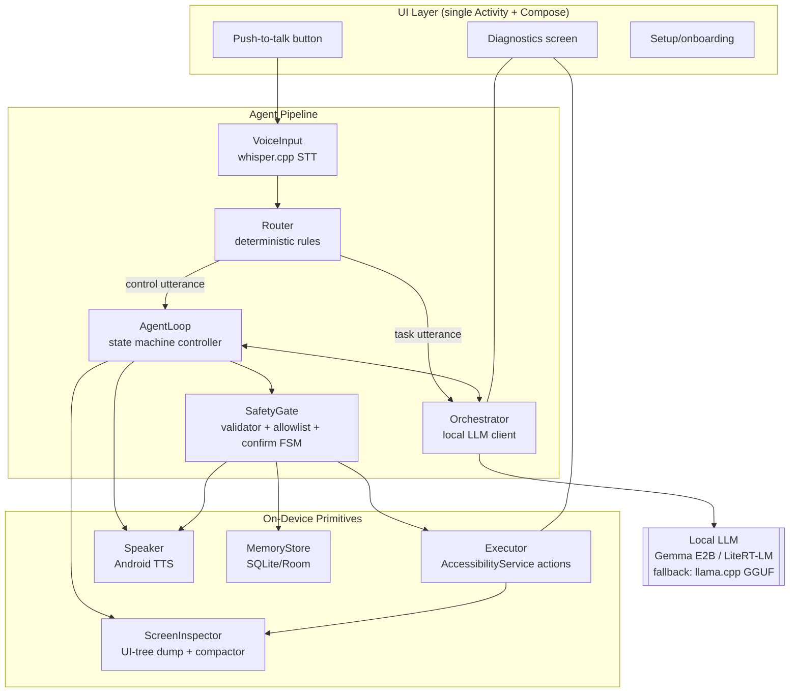
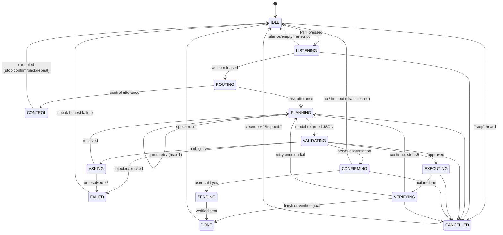
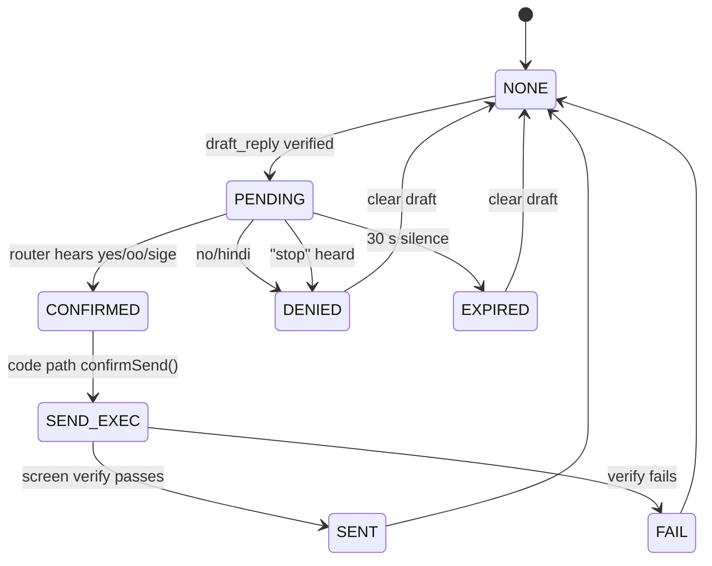

# 04 — Architecture

| | |
|---|---|
| **Upstream** | 01-PRD, 02-MVP-Scope, 03-User-Flow |
| **Downstream** | 05-Architecture-Essentials (non-negotiables), 06-TRD (stack/repo analysis), 07-Agent-Specs (contracts), 08-Development-Plan (tasks) |

Stack: **native Android, Kotlin** (see 06-TRD §0.5 — the reference repo's Flutter shell is not reused; its Kotlin accessibility layer is ported).

## 1. Component Diagram



**Hard boundary:** `Orchestrator` output never reaches `Executor`. Everything funnels through `SafetyGate`. The model proposes; code disposes.

## 2. Data Flow (one command cycle)

1. `VoiceInput` records audio (≤10 s, PCM 16 kHz mono) → whisper.cpp → transcript string. Audio buffer discarded after transcription (never written to disk).
2. `Router` regex/keyword-matches control utterances. Match → direct action (cancel/confirm/back/open_app/repeat/ordinal answer). No match → pass transcript to `AgentLoop`.
3. `AgentLoop` enters PLANNING: `ScreenInspector.dump()` produces a ≤60-element compact list; `Orchestrator.planStep()` sends system prompt + task + dump + last result to the LLM → returns one `ActionV1` JSON.
4. `SafetyGate.validate(action)`: schema check, tool allowlist, forbidden-domain screen check, target verification. Produces `Approved | NeedsConfirmation | Rejected | AskUser`.
5. Approved → `Executor` performs it → `ScreenInspector.dump()` again → verification result appended → next loop iteration (max 5).
6. NeedsConfirmation → Speaker reads recipient+text → router listens for yes/no → on yes, **code** (not model) runs `confirmSend()`.
7. `finish` or cap → Speaker speaks outcome. Diagnostics records latency.

## 3. Modules — Responsibilities and Interfaces

| Module | Responsibility | Key interface (Kotlin) | Reuse source (see 06-TRD §0.5) |
|---|---|---|---|
| `VoiceInput` | PTT capture, whisper.cpp inference, discard audio | `suspend fun transcribe(pcm: ShortArray): String` | New — repo's `speech_to_text` plugin is replaced |
| `Router` | Deterministic control phrases | `fun route(t: String): RouteResult` (Control/Task/Answer) | Inspired by repo's `_getNavigationShortcut`, rewritten |
| `Orchestrator` | LLM session, prompt assembly, JSON parse, 1 parse-retry | `suspend fun planStep(ctx: PlanContext): ActionV1` | Rewritten — repo's `AiService` is cloud HTTP |
| `SafetyGate` | Schema validation, allowlist, blocklist, confirm FSM, target verification | `fun validate(a: ActionV1, s: ScreenModel): Verdict` | New — no equivalent in repo |
| `AgentLoop` | Step loop ≤5, retry rules, cancel token, state machine | `suspend fun run(task: String, scope: CoroutineScope)` | Pattern ported from repo's `TaskExecutor` (Kotlin rewrite) |
| `ScreenInspector` | UI-tree traversal → `ScreenModel`; compactor | `fun dump(): ScreenModel` | Ported from repo's `AgentAccessibilityService.dumpScreen` + `getCompressedScreenDescription` |
| `Executor` | click/scroll/back/open/draft_reply; `confirmSend()` is code-only | `suspend fun perform(a: ActionV1): ExecResult` | Ported from repo's accessibility actions (`clickByText`, `dispatchGesture`, `ACTION_SET_TEXT`) |
| `Speaker` | Offline TTS queue, barge-in stop | `fun speak(tpl: Tpl, vararg args)`, `fun stop()` | Rebuilt on `TextToSpeech` directly (repo used `flutter_tts`) |
| `MemoryStore` | Aliases, prefs, rolling context | `fun resolveAlias(name): List<Contact>` etc. | New (repo's skill-memory is out of scope) |
| `Diagnostics` | Model name, last latency, net status, pipeline state | `object DiagnosticsBus : StateFlow` | New |

## 4. Threading and Responsiveness

- All agent work on `Dispatchers.Default`; `Executor` calls into the AccessibilityService on `Dispatchers.Main` only where required (gestures dispatch async via `dispatchGesture` callback).
- LLM and whisper run in a single dedicated `Dispatcher` limited to 1 worker (they're heavyweight; serialize them) — backed by a `Process`-safe JNI wrapper.
- **Cancel:** `kotlinx.coroutines.Job` per task; "stop" calls `job.cancel()` — checked between steps and inside LLM via periodic `ensureActive()`/abort hooks. Whisper/llama.cpp inference supports early abort via callback returning false.
- TTS is interruptible (`speaker.stop()` on cancel). Screen dump is the only blocking call and times out at 3 s.
- UI is never blocked: PTT button stays responsive during inference; a visible + spoken "Stop" affordance is always present.

## 5. Agent Loop State Machine



## 6. Confirmation Gate State Machine (FR-07)



Rules: (a) `SEND_EXEC` is reachable **only** from `CONFIRMED`; the model's tool set contains no send primitive. (b) Draft field is cleared on any non-SENT exit. (c) Pending state expires in 30 s.

## 7. Memory Schema (SQLite via Room — `alalay.db`)

```sql
CREATE TABLE aliases (
  id INTEGER PRIMARY KEY AUTOINCREMENT,
  alias TEXT NOT NULL,          -- "Mama" — what the user says
  target_name TEXT NOT NULL,    -- "Remedios Domingo" — canonical contact/thread name
  target_kind TEXT NOT NULL,    -- 'contact' | 'thread' | 'app'
  created_at INTEGER NOT NULL
);

CREATE TABLE prefs (
  key TEXT PRIMARY KEY,         -- 'speak_language' | 'speech_rate'
  value TEXT NOT NULL
);

CREATE TABLE rolling_context (
  key TEXT PRIMARY KEY,         -- 'last_contact' | 'last_task_kind'
  value TEXT NOT NULL,
  updated_at INTEGER NOT NULL
);
```

Hard rules: no message bodies ever stored; writes require explicit spoken confirmation (teach flow in 03 §1.7 and post-task "want me to remember?"); model has **no memory-write tool** (07-Agent-Specs §9).

## 8. Reference Repo Fit (summary — full analysis in 06-TRD §0)

| Repo module | Alalay destination | Verdict |
|---|---|---|
| `AgentAccessibilityService.kt` | `Executor` + `ScreenInspector` | **Port** (Kotlin→Kotlin, adapt; license VERIFY) |
| `TaskExecutor` loop + guards | `AgentLoop` | **Port pattern**, rewrite in Kotlin |
| `getCompressedScreenDescription` | `ScreenInspector` compactor | **Port pattern** |
| `AiService` (cloud) | `Orchestrator` | **Rewrite** — on-device inference |
| `VoiceService` | `VoiceInput` | **Rewrite** — whisper.cpp |
| Telegram/Shizuku/SMS/call/system-control services | — | **Drop** (network/scope/safety) |
| Skill memory | — | Drop (stretch idea) |
